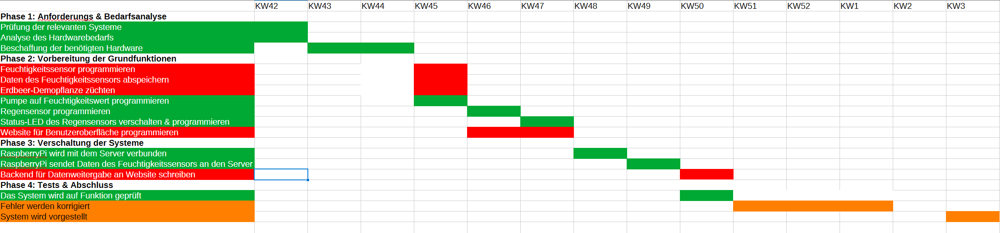

# Projektplan SmartStrawberries

## Projektübersicht

- Projektname: Smart Strawberries
- Projektteilnehmer: Finn Brunner, Ann-Kathrin Kostal

## Ausgangssituation
Viele Menschen möchten gesünder leben und dazu ihr eigenes Obst anbauen. Leider beschweren sich viele von ihnen, dass die Pflanzen nicht gedeihen oder die Ernte zu gering ausfällt.
Außerdem wissen viele Personen nicht, wie viel Wasser Erdbeerpflanzen überhaupt benötigen. Dieses Problem kann mit einer Automatisierung behoben werden, bei der ein System die Daten der Bewässerung überwacht und die Pflanzen selbstständig bewässert.

## Projektziele
Das System soll Menschen helfen, die entweder nicht über das nötige Wissen oder die nötige Zeit verfügen, sich um ihre Obstpflanzen zu kümmern. Das System überwacht dabei die Feuchtigkeit der Erde.
Wenn die Feuchtigkeit unter einen bestimmten Wert fällt, wird mithilfe einer Pumpe das Wasser aus einem Behälter in die Pflanze gepumpt. Der Nutzer muss somit nur noch den Wasserstand des Behälters im Auge behalten.
Den aktuellen Feuchtigkeitswert kann der Nutzer über eine Website anschauen und kann so überpfüfen, ob das System funktioniert.
Außerdem verfügt das System über einen Niederschlagssensor. Dabei leuchtet bei Niederschlag eine Blaue Lampe. Dadurch wird der Nutzer informiert, dass das System aufgrund der natürlichen Wasserzufuhr seine nächsten Bewässerungsvorgänge erst einige Zeit später ausführen wird und der Nutzer für einige Zeit kein Wasser mehr in den Behältr nachfüllen muss.

## Projektumfang
Im Projektumfang enthalten sind:
- Sensorsteuerung und Pumpensteuerung über Raspberry Pi
- Anbindung an Server und Übermittlung der Feuchtigkeitsdaten
- Website für den Benutzer, um Feuchtigkeitsdaten auszulesen
- Regensensor um die natürliche Bewässerung zu kennzeichnen

## Arbeitspakete

### Phase 1: Anforderungs und Bedarfsanalyse

    - Ziel: Anforderungen an Soft- und Hardware sind herausgearbeitet
    - Aufgaben: Ausarbeitung der benötigten Hardwarekomponenten, Recherche über notwendige Software
    - Verantwortlich: Finn Brunner
    - Ergebnis: Liste mit benötigter Software steht, Hardware wurde bestellt
    - Arbeitsaufwand: ~10 Stunden

### Phase 2: Vorbereitung der Grundfunktionen

    - Ziel: Sensoren und andere Hardwarekomponenten sind vorbereitet auf Verschaltung
    - Aufgaben: Feuchtigkeitssensor programmieren und Daten abspeichern, Regensensor mit Status-LED programmieren, Pumpe programmieren, Website entwerfen
    - Verantwortlich: Finn Brunner, Ann-Kathrin Kostal
    - Ergebnis: Hardware wird von Raspberry Pi angesteuert, Template der Website steht für Serverintegration bereit
    - Arbeitsaufwand: ~25 Stunden

### Phase 3: Verschaltung der Systeme

    - Ziel: Raspberry Pi wird mit Server verbunden, Website zeigt Daten an
    - Aufgaben: Raspberry Pi mit Server verbinden, Feuchtigkeitsdaten übermitteln, Backend für Website-Template schreiben
    - Verantwortlich: Finn Brunner, Ann-Kathrin Kostal
    - Ergebnis: System bewääsert die Pflanze und die Feuchtigkeit der Erde kann über die Website ausgelesen werden
    - Arbeitsaufwand: ~25 Stunden

### Phase 4: Tests & Abschluss

    - Ziel: System funktioniert einwandfrei und wird präsentiert
    - Aufgaben: Test des Systems, Behebung der Fehler, Präsentation des Systems
    - Verantwortlich: Finn Brunner, Ann-Kathrin Kostal
    - Ergebnis: Einwandfrei funktionierendes System wurde vorgestellt
    - Arbeitsaufwand: ~10-20 Stunden

## Gannt-Diagramm

Das folgende Gantt-Diagramm zeigt die zeitliche Planung der Arbeitspakete

## Meilensteine

    -Meilenstein 1: Hard- und Softwareanforderungen sind ausgearbeitet
    -Meilenstein 2: Hardwareprogrammierung abgeschlossen
    -Meilenstein 3: Einzelne Systeme sind verschaltet
    -Meilenstein 4: Tests wurden durchgeführt
    -Meilenstein 5: Fehler wurden behoben
    -Meilenstein 6: Projekt wurde vorgestellt

## Risikomanagement und Kommuniaktion
Sollten Probleme auftreten, so werden diese sofort in der Gruppe besprochen. Sollte ein anderes Teammitglied eine Lösungsidee haben, wird die Aufgabe an dieses Mitglied übertragen.
Die Kommunikation dazu findet über eine WhatsApp-Gruppe sowie ein Kanban-Board statt. Das Kanban Board wird dabei für die Zuteilung von Aufgaben verwendet und die WhatsApp Gruppe dient zur Notfallkommunikation bei technischen Problemen, die schnelle Handlungen erfordern.

## Projektabschluss
Am Ende wird das Projekt auf der Projektmesse präsentiert. Danach wird der Ablauf der Päsentation teamintern reflektiert und das möglicherweise erkannte Verbesserungspotential besprochen.
Am Ende nehmen beide Teammitglieder noch an einem Abgabegespräch teil. 

